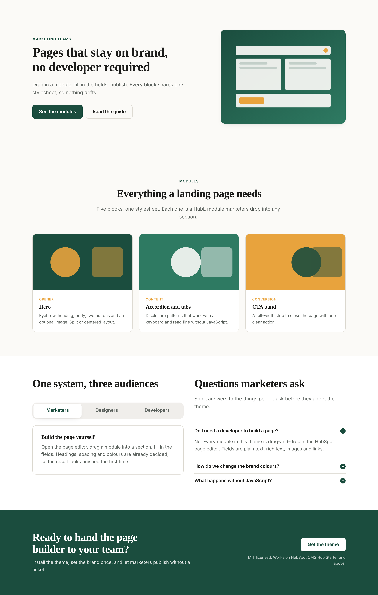

# hubl-module-kit

A HubSpot CMS theme ("Northwind") built around one idea: marketers assemble
landing pages from drag-and-drop HubL modules, and every module draws from a
single brand stylesheet that theme settings control. Nothing on the page can
drift off brand, and nobody has to open a ticket to ship a page.

The repository also shows the workflow around the theme: a local preview that
renders the real template and modules without a HubSpot account, and a set of
static checks that run before every upload.



## Modules

All five live in `src/theme/modules/` and follow the standard layout
(`module.html`, `fields.json`, `meta.json`, `module.css`).

| Module | What it does |
| --- | --- |
| `hero.module` | Page opener: eyebrow, heading (H1 or H2), rich-text body, two buttons, optional image; split or centered layout. |
| `accordion.module` | FAQ-style disclosure list. One or many panels open, keyboard navigation, panels readable without JavaScript. |
| `tabs.module` | WAI-ARIA tabs with automatic or manual activation; renders as stacked sections when JavaScript is off. |
| `card-grid.module` | Two to four column card grid fed by a repeater group, or by a HubDB table (see below). |
| `cta-band.module` | Full-width closing strip with heading, supporting text, button and small print; three background tones. |

Markup details that matter for accessibility: a heading-level choice on each
module so the page keeps a sane outline, `aria-expanded` / `aria-controls` on
accordion triggers, `role="tablist"` / `role="tab"` / `role="tabpanel"` with
roving tabindex, visible focus rings via one shared token, and a
`prefers-reduced-motion` guard that disables every transition.

### Card grid: repeater or HubDB

The module has a `source` choice. With `repeater` (default) marketers edit
cards inline. With `hubdb`, the `hubdb_table` field appears and `module.html`
switches to `hubdb_table_rows(module.hubdb_table)`. Both paths render through
the same macro, so the markup is identical. The table needs these columns:

| Column | Type |
| --- | --- |
| `title` | Text |
| `description` | Rich text |
| `image` | Image |
| `link` | URL |
| `tag` | Select |

## Local preview

```
npm install
npm run preview
```

`preview/build.js` renders `src/theme/templates/landing-page.html` to
`preview/dist/index.html`, then serves it at `http://localhost:4173/` and opens
a browser. `npm run preview:build` renders without serving.

How it works:

1. `preview/lib/theme-fields.js` turns `src/theme/fields.json` defaults into
   the `theme` object HubL exposes (so `{{ theme.colors.primary.color }}`
   resolves exactly as it would on HubSpot).
2. `preview/lib/hubl.js` wraps Nunjucks, which already implements the Jinja
   core that HubL is built on, and adds the HubSpot-specific pieces this theme
   uses: `dnd_area`, `dnd_section`, `dnd_column`, `dnd_row` and `dnd_module`
   tags, module rendering with `fields.json` defaults merged with template
   parameters, and stubs for `require_css`, `require_js`, `get_asset_url`,
   `standard_header_includes` and `hubdb_table_rows`.
3. `preview/sample-data/*.json` overrides field values per module, standing in
   for what a marketer would type in the editor (images, longer copy, the
   HubDB variant).
4. `preview/preview.css` stands in for HubSpot's `layout.css` so drag-and-drop
   columns get a 12-column grid.

Known limits of the subset: no `` or ``
tags, no HubSpot-only filters beyond `striptags`, `escape_html` and `tojson`,
no ``, no partial/global modules, `get_asset_url` only resolves paths
inside the theme, and `hubdb_table_rows` ignores its query string. Anything
outside that list should be verified on a HubSpot sandbox before release.

## Checks

```
npm test
```

`scripts/check-modules.js` runs five checks with no dependencies and exits
non-zero on the first problem:

1. Every module folder has `module.html`, `fields.json`, `meta.json` and
   `module.css`, and `meta.json` has the keys HubSpot requires.
2. Every `fields.json` (theme and modules) is well formed: known field types,
   snake_case names unique per level, `choices` present with a valid default,
   defaults matching the declared type, repeaters with an `occurrence` block.
3. Every `module.html` references only declared fields, including group
   children, loop variables over repeaters, and the sub-properties a field
   type actually exposes (`link.url.href`, `image.src`, and so on).
4. Every `dnd_module` in a template points at a real module and passes only
   declared field names.
5. No stylesheet hardcodes a colour outside the `:root` token block in
   `css/main.css`. Hex values, `rgb()`/`hsl()` calls and named colours in a
   module stylesheet fail the build.

Example output:

```
 ok   module folders are complete
 ok   fields.json files are well formed
 ok   module.html files reference only declared fields
 ok   templates point at existing modules and pass declared fields
 ok   CSS uses theme variables instead of hardcoded colours

All 5 checks passed for 5 modules.
```

## How theme fields reach the CSS

`src/theme/fields.json` declares three groups of theme settings: colours,
typography (two font fields) and spacing. HubSpot processes `css/main.css` as
HubL, so the top of that file writes each setting into a custom property:

```css
:root {
  --nw-color-primary: {{ theme.colors.primary.color }};
  --nw-font-heading: "{{ theme.typography.heading.font }}", {{ theme.typography.heading.fallback }};
  --nw-section-pad-top: {{ theme.spacing.section.padding.top.value }}{{ theme.spacing.section.padding.top.units }};
  --nw-radius: {{ theme.spacing.radius }}px;
}
```

Module stylesheets only ever use `var(--nw-*)`. Changing the primary colour in
Design Manager therefore restyles every button, tab, card accent and CTA band
on every page at once, and the CSS check keeps it that way.

## Upload to HubSpot

The theme is a plain HubSpot CLI project.

```
npm install -g @hubspot/cli
hs init                      # once: connect a portal, writes hubspot.config.yml
npm test                     # make sure the checks pass
npm run upload               # hs upload src/theme northwind-theme
hs watch src/theme northwind-theme   # optional: upload on save while developing
```

After the first upload the theme appears under Design Manager as
`northwind-theme`, the landing-page template is available when creating a
page, and the five modules show up in the page editor's module list under the
"Northwind" tag.

## Project layout

```
src/theme/            the HubSpot theme (what `hs upload` sends)
  theme.json
  fields.json         theme settings: colours, typography, spacing
  css/main.css        brand stylesheet, HubL in CSS
  js/main.js          accordion and tabs enhancement
  templates/          landing-page.html (dnd_area) and layouts/base.html
  modules/            five drag-and-drop modules
preview/              local renderer, sample data and output (dist/ is ignored)
scripts/              check-modules.js (npm test), screenshot.js
docs/                 preview screenshot
```

## Background

This mirrors a design system I built and maintain for a publisher's marketing
team: a theme-settings-driven stylesheet, a module library the team composes
pages from without developer involvement, and a local preview plus checks so
changes are reviewed before they reach the portal. Names, copy and branding
here are invented.

## License

MIT. See `LICENSE`.
